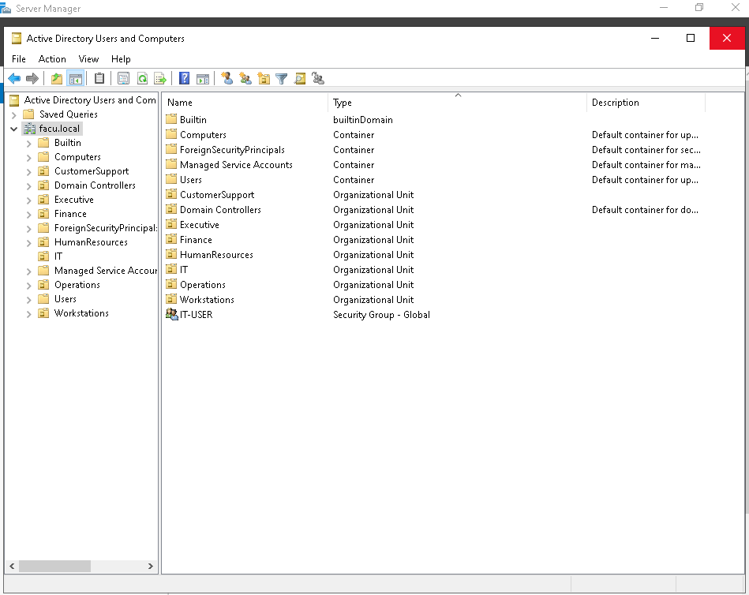
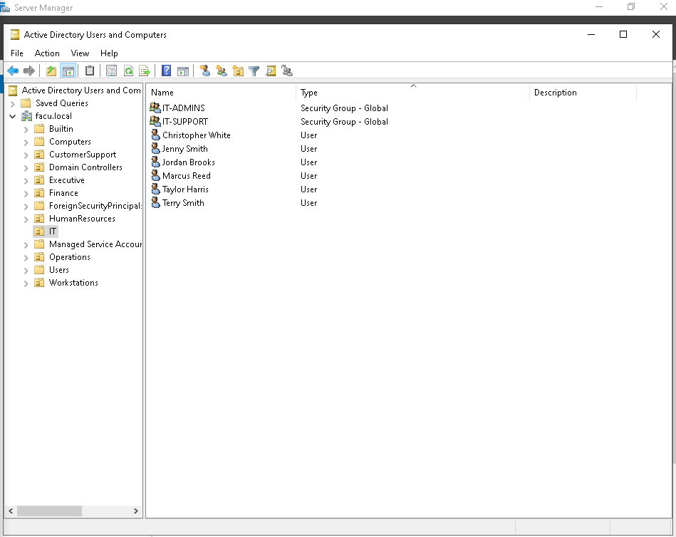
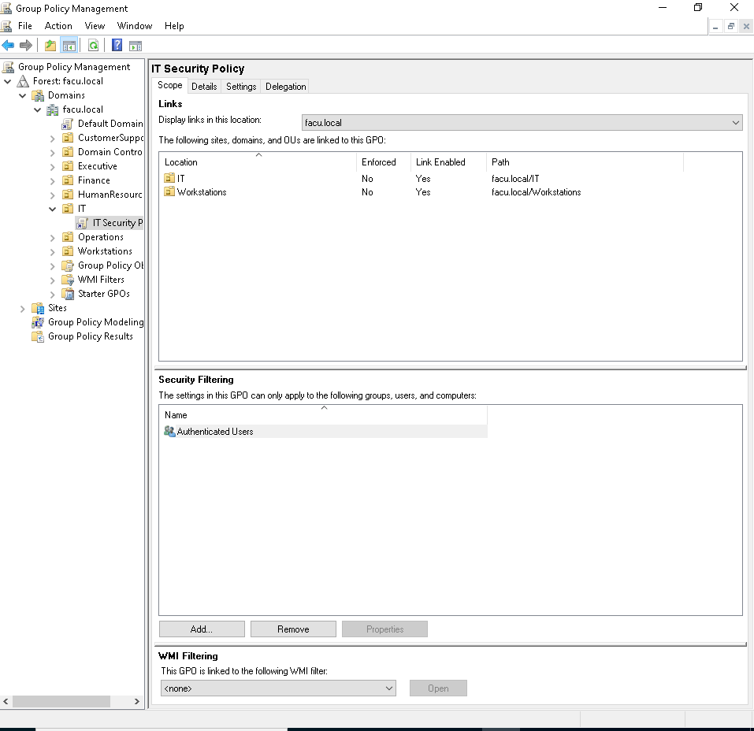
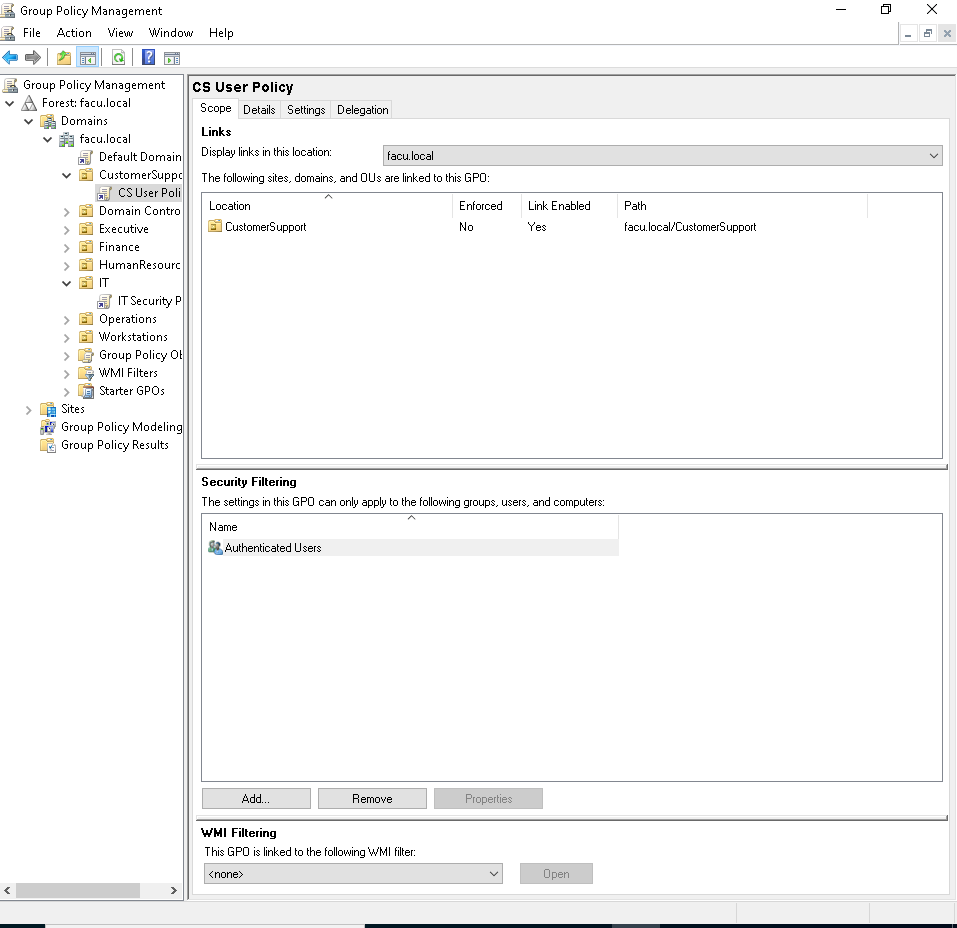
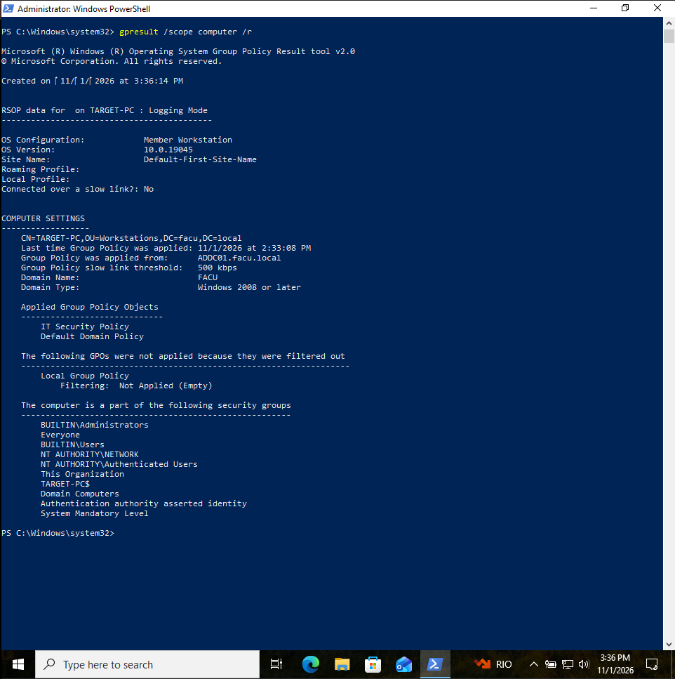
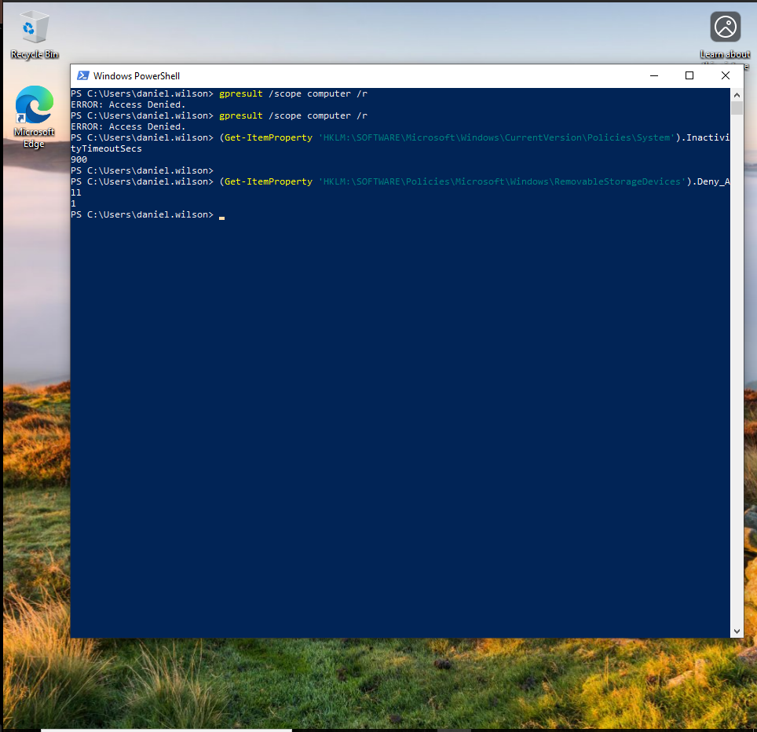
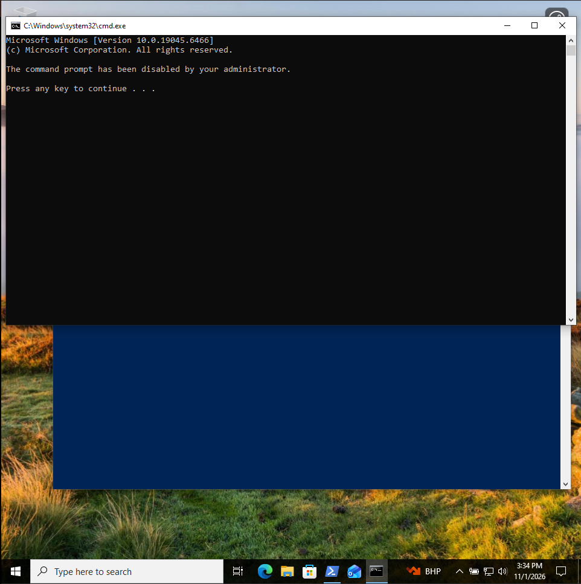
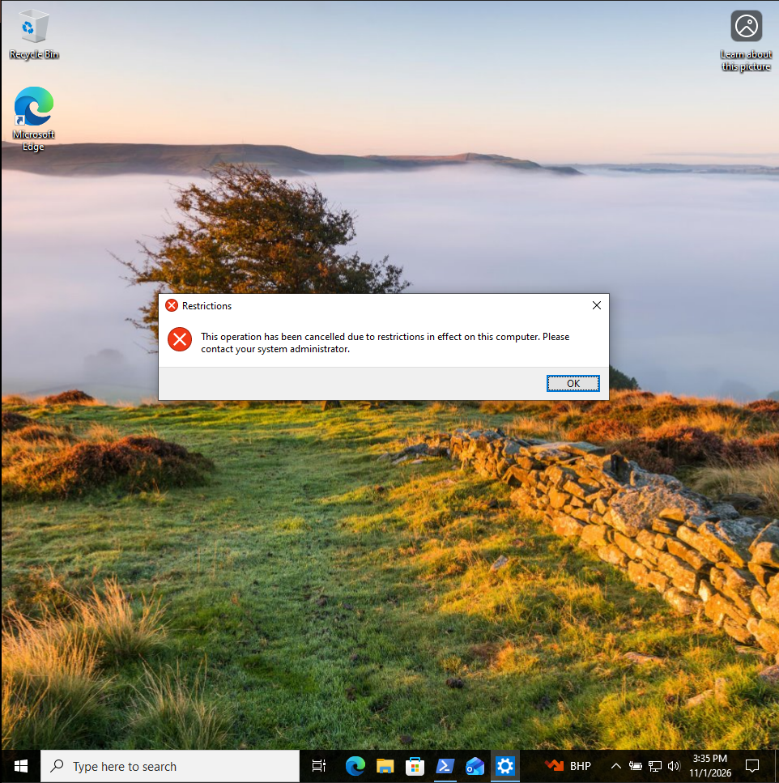

# Active Directory Enterprise Lab

**Windows Server | Active Directory Domain Services | DNS | Group Policy | Windows 10 | VirtualBox**

## Overview

This project documents a virtualized Windows domain environment built to practice core IT support and junior systems administration tasks: domain deployment, identity and group management, organizational unit (OU) design, Group Policy configuration, client domain join, and troubleshooting.

The lab uses a Windows Server domain controller and a domain-joined Windows 10 workstation. Policies were validated on the client using `gpresult`, `gpupdate`, and Windows Registry checks.

> **Environment:** Isolated home lab for learning and demonstration; not a production deployment.

## Verified outcomes

| Test | Observed result |
|---|---|
| Domain membership | `TARGET-PC` joined `facu.local` |
| Domain controller discovery | `ADDC01.facu.local` (`192.168.10.7`) |
| IT workstation policy | `IT Security Policy` shown in `gpresult` |
| Inactivity limit | `InactivityTimeoutSecs = 900` |
| Removable storage policy | `Deny_All = 1` |
| Customer Support policy | `CS User Policy` shown in user `gpresult` |
| Customer Support restrictions | Control Panel and CMD blocked |

**Portfolio highlights:** [Architecture](#lab-architecture) · [GPO troubleshooting](#phase-4--domain-join-validation-and-troubleshooting) · [Evidence screenshots](#evidence-and-screenshots) · [Lessons learned](#troubleshooting-lessons)

## Lab architecture

| Component | Hostname / Domain | Address | Purpose |
|---|---|---|---|
| Domain controller | `ADDC01.facu.local` | `192.168.10.7` | AD DS, DNS, Group Policy management |
| Windows 10 workstation | `TARGET-PC` | `192.168.10.100` | Domain authentication and GPO validation |
| Active Directory domain | `facu.local` | — | Identity and policy management |
| Virtualization | VirtualBox | — | Lab infrastructure |

**Network:** `192.168.10.0/24` (lab subnet).

```text
                 VirtualBox lab network (192.168.10.0/24)
               ┌──────────────────────────────────────────┐
               │                                          │
     ┌─────────┴──────────┐                    ┌──────────┴─────────┐
     │ ADDC01             │                    │ TARGET-PC          │
     │ Windows Server     │   Domain join /    │ Windows 10         │
     │ 192.168.10.7       │◄──────────────────►│ 192.168.10.100     │
     │ AD DS + DNS + GPO  │   authentication   │ GPO verification   │
     └────────────────────┘                    └────────────────────┘
                        Domain: facu.local
```

## Phase 1 — Domain infrastructure

- Deployed Windows Server as the domain controller `ADDC01`.
- Configured Active Directory Domain Services and DNS for `facu.local`.
- Verified that the workstation could locate the domain controller.

**Validation on TARGET-PC:**

```powershell
(Get-CimInstance Win32_ComputerSystem) | Select-Object Name,Domain,PartOfDomain
nltest /dsgetdc:facu.local
```

Observed: `PartOfDomain = True`; domain controller resolved to `ADDC01.facu.local` at `192.168.10.7`.

## Phase 2 — Organizational units, users and groups

Created OUs for:

- IT
- HumanResources
- Finance
- CustomerSupport
- Operations
- Executive
- Workstations

Created and verified the following security group memberships:

| Group | Members |
|---|---|
| `IT-ADMINS` | Marcus Reed, Jordan Brooks |
| `IT-SUPPORT` | Christopher White, Taylor Harris |
| `HR-USERS` | Sarah Mitchell, Jennifer Clark |
| `FINANCE-USERS` | Michael Thompson, Emily Davis |
| `EXECUTIVE-USERS` | Ashley Carter |

Created `daniel.wilson` in `OU=CustomerSupport` for the user-policy validation test.

**Sample verification on ADDC01:**

```powershell
Get-ADUser "marcus.reed" -Properties Enabled,UserPrincipalName |
    Select-Object Name,Enabled,UserPrincipalName,DistinguishedName

Get-ADGroupMember "IT-ADMINS" | Select-Object Name,SamAccountName
Get-ADComputer "TARGET-PC" | Select-Object Name,DistinguishedName
```

## Phase 3 — Group Policy

Configured two department-focused GPOs:

### IT Security Policy

**Computer Configuration** settings observed in the GPO report:

- **Machine inactivity limit:** 900 seconds (15 minutes).
- **Removable storage:** Deny access to all removable storage classes.
- **Password settings present in the GPO:** minimum length 12 characters; password complexity enabled.

**Important implementation note:** Password settings in a GPO linked only to an OU do not establish the domain password policy for domain user accounts. Domain-wide password requirements must be configured through the appropriate domain-level policy, or granular requirements through Fine-Grained Password Policies (PSOs).

### CS User Policy

**User Configuration** restrictions tested on a Customer Support account:

- Control Panel access restricted.
- Command Prompt (`cmd.exe`) access restricted.

## Phase 4 — Domain join, validation and troubleshooting

### Domain authentication

- `TARGET-PC` joined `facu.local` successfully.
- `nltest /dsgetdc:facu.local` located `ADDC01.facu.local`.
- Signed into the workstation with domain users `FACU\marcus.reed` and `FACU\daniel.wilson`.

### IT GPO application

**Issue:** The IT GPO was linked to `OU=IT`, but its configured restrictions were under **Computer Configuration**. The workstation was in `OU=Workstations`, so signing in with an IT user alone did not bring that computer into scope.

**Resolution:** Linked `IT Security Policy` to `OU=Workstations`, keeping the workstation in its designated OU.

**Validation on TARGET-PC (elevated PowerShell):**

```powershell
gpupdate /force
gpresult /scope computer /r

Get-ItemProperty `
    -Path 'HKLM:\SOFTWARE\Microsoft\Windows\CurrentVersion\Policies\System' `
    -Name InactivityTimeoutSecs

Get-ItemProperty `
    -Path 'HKLM:\SOFTWARE\Policies\Microsoft\Windows\RemovableStorageDevices' `
    -Name Deny_All
```

**Observed results:**

```text
Applied Group Policy Objects
----------------------------
    IT Security Policy
    Default Domain Policy

InactivityTimeoutSecs : 900
Deny_All              : 1
```

These checks demonstrate that the GPO was applied and its policy values reached the client. They are **configuration checks**, not a substitute for an end-to-end physical USB-device test or timed inactivity test.

### Customer Support user GPO

Signed into `TARGET-PC` as `FACU\daniel.wilson`, whose account resides in `OU=CustomerSupport`.

```powershell
gpupdate /force
gpresult /scope user /r
```

**Observed result:**

```text
Applied Group Policy Objects
----------------------------
    CS User Policy
```

Functional tests: Windows blocked Control Panel access and, after configuring the corresponding policy setting, Command Prompt access for the Customer Support user.

## Troubleshooting lessons

1. **GPO scope matters:** A computer setting is evaluated against the computer object’s OU, not automatically against the OU of the signed-in user.
2. **Successful `gpupdate` is not proof that a particular GPO applied:** Confirm effective policies with `gpresult`.
3. **Check both policy sections:** A GPO can be enabled while containing only computer-side or only user-side settings.
4. **Use least-impact changes:** Fix the appropriate policy link or security scope instead of moving accounts between unrelated OUs.
5. **Validate actual settings:** Confirm policy values in the registry and test visible restrictions using a non-administrative domain user.

## Evidence and screenshots

The following screenshots were captured from the working VirtualBox lab.

### Active Directory structure



*Organizational Units organized by department under `facu.local`.*



*IT OU containing security groups and test user accounts.*

### Group Policy scope



*`IT Security Policy` linked to the IT and Workstations OUs.*



*`CS User Policy` linked to the CustomerSupport OU.*

### Workstation policy validation



*`gpresult` confirms that TARGET-PC receives `IT Security Policy`.*



*Registry checks show a 900-second inactivity timeout and `Deny_All = 1`. The screenshot also contains earlier permission errors from a non-elevated `gpresult` attempt; the policy values themselves were retrieved successfully.*

### Customer Support restrictions



*Command Prompt blocked for the Customer Support test user.*



*Windows blocks Control Panel access under the Customer Support user policy.*

> The screenshots document configuration and observable behavior in a test environment. They do not contain production systems.

## Skills demonstrated

- Windows Server administration
- Active Directory Domain Services (AD DS)
- DNS and domain join troubleshooting
- OU and security group administration
- Group Policy design, linking, refresh, and Resultant Set of Policy checks
- PowerShell-based validation
- Investigation and resolution of policy scope issues

## Next improvements

- Separate workstation OUs by department to prevent broad computer-policy targeting.
- Review GPO security filtering and delegated administration.
- Build a reusable PowerShell provisioning script with safe, non-hardcoded credential handling.
- Add controlled test evidence for actual inactivity lock and removable media restrictions.
- Document a rollback procedure and maintain offline VM backups.

---

*Built as a hands-on learning and portfolio project. All test names and internal addresses shown here belong to the lab environment.*
